# 🔗 CertChain: Blockchain-Based Academic Certificate Verification

> A permissioned blockchain that lets **anyone verify an academic certificate in seconds**, with no phone call to the university, no paperwork, and no way to forge a grade.

**Author:** Shreeya Tapaswi (31474) · Blockchain Technology Mini Project
**Stack:** Python · Flask · SHA-256 · Ed25519 · Merkle trees · Proof of Work · vanilla JS

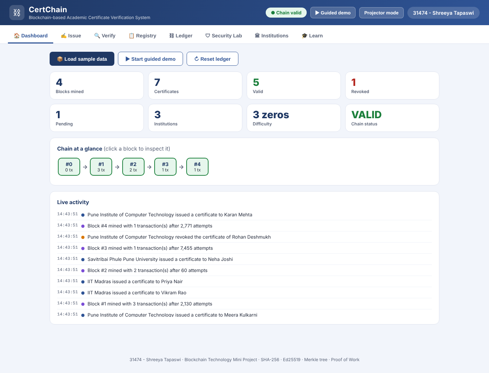

---

## 📌 The problem

Fake degrees are a real, expensive problem. Verifying a certificate today means emailing the university, waiting days, and trusting a PDF or a paper stamp that is easy to forge.

## 💡 The solution

Each certificate is reduced to a **SHA-256 fingerprint** and recorded on a tamper-evident ledger by the issuing institution, **digitally signed with its private key**. Verification becomes a mathematical check anyone can run:

> *Does this exact certificate's fingerprint exist on the ledger, signed by an authorised institution, and not revoked?*

Change a single character (a grade, a name, a date) and the fingerprint is completely different, so verification fails.

**Privacy by design:** only the hash goes on-chain. No names, grades or student IDs are ever stored in a block.

---

## ✨ Features

| | Feature | What it does |
|---|---|---|
| ✍️ | **Issue** | Single or bulk (CSV) certificate issuing, signed with the institution's Ed25519 key |
| 🔍 | **Verify** | Step-by-step verification: fingerprint → ledger lookup → issuer → signature → block integrity → revocation |
| 📄 | **Printable certificate + QR** | Every certificate gets a public verify link and a scannable QR code (works from a phone on the same Wi-Fi with `--lan`) |
| 🚫 | **Revocation** | Only the *issuing* institution can revoke, and the revocation is itself on the ledger |
| ⛓ | **Ledger explorer** | Inspect blocks, hashes, nonces, and the full **Merkle tree** of every block |
| 🛡 | **Security Lab** | Launch 5 real attacks (fake university, forged signature, replay, rival revocation, upgraded grade) and watch each get blocked |
| 😈 | **Tamper simulator** | A *naive* attacker breaks the Merkle root; a *smart* attacker who re-mines the block still breaks the next block's link |
| 🏛 | **Multi-institution** | Register institutions, each with its own key pair |
| 🎓 | **Guided demo & Learn tab** | A built-in walkthrough for presentations (with projector mode) |

---

## 📸 Screenshots

### Issue a certificate
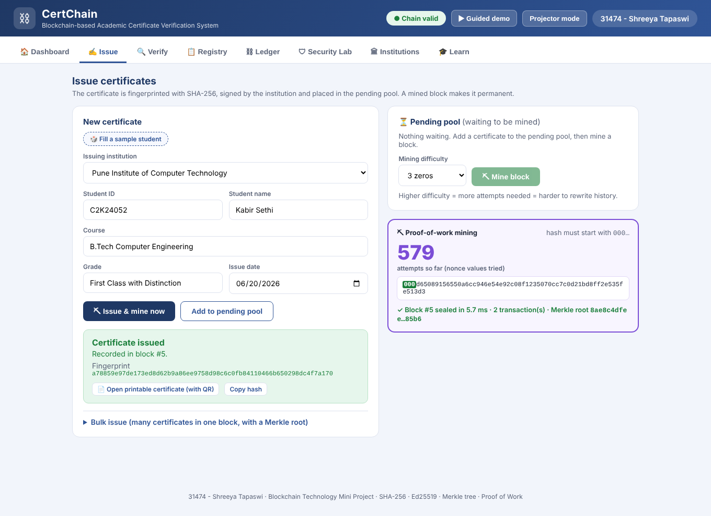

### Verification: authentic ✅
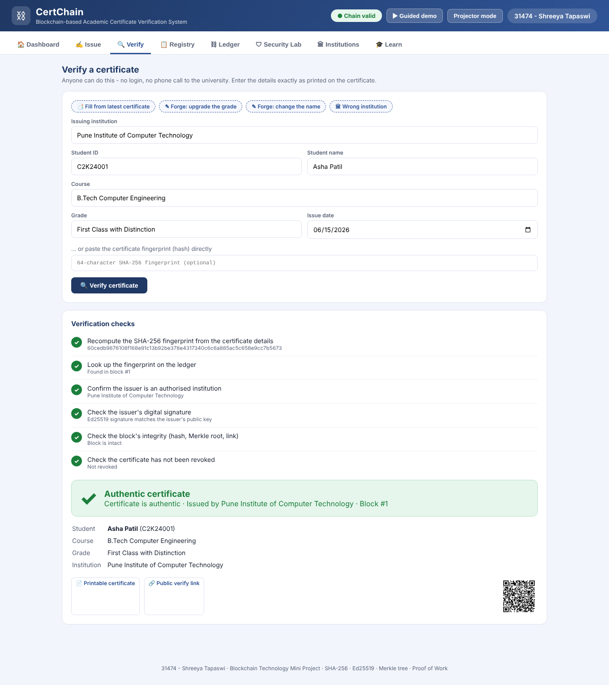

### Verification: forged grade ❌
Upgrading *"First Class with Distinction"* to *"Distinction with Honours"* produces a completely different fingerprint, which is not on the ledger.

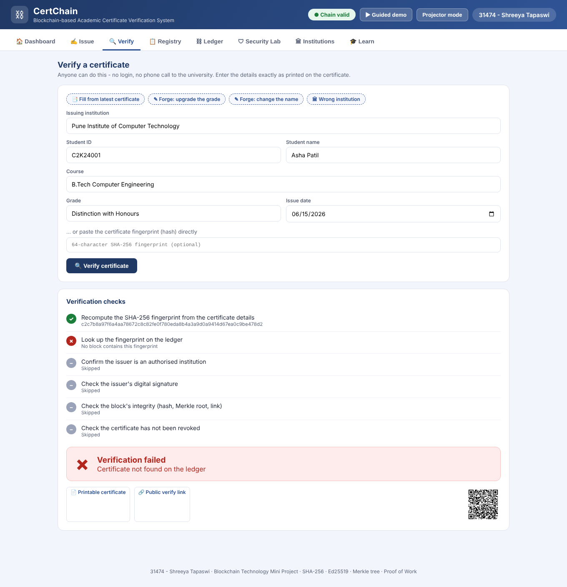

### Verification: revoked certificate
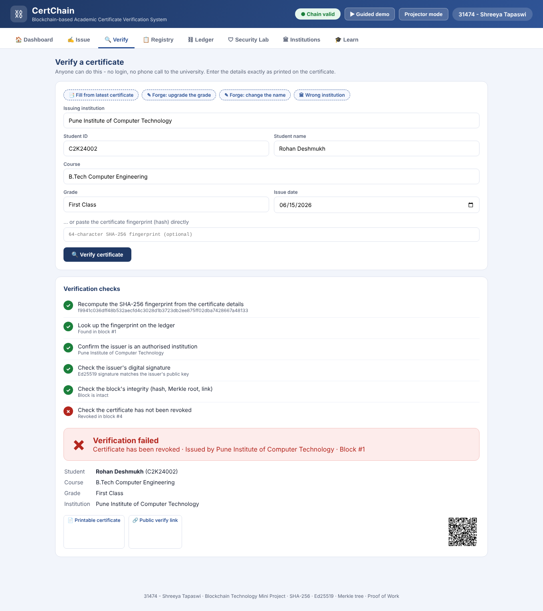

### Registry
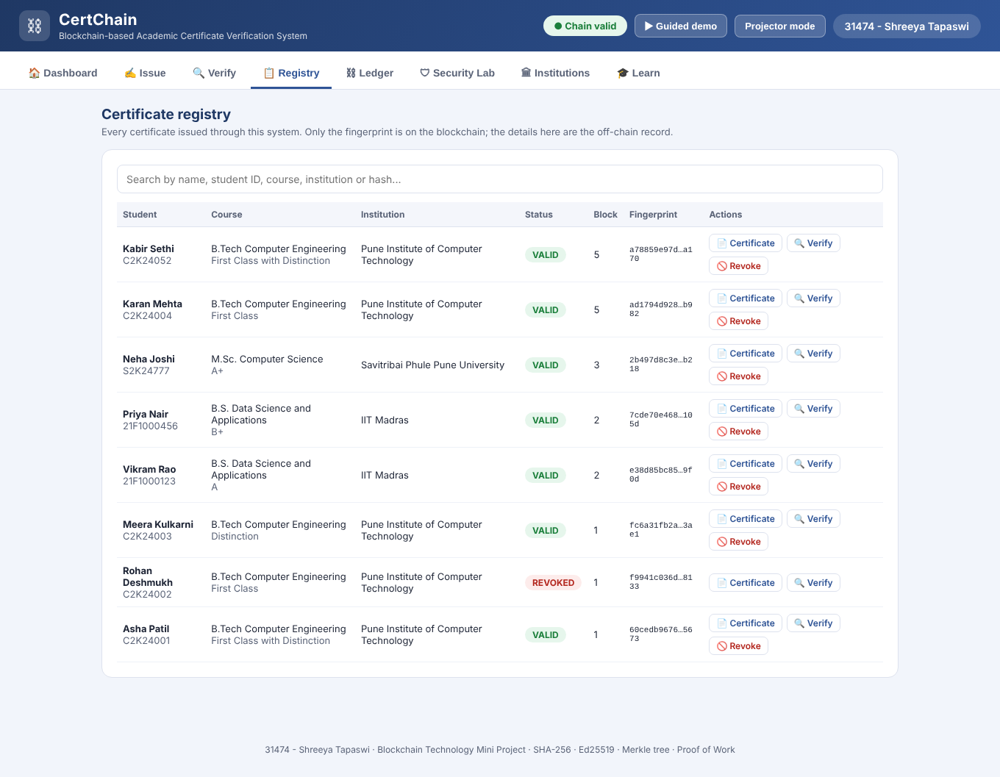

### Ledger explorer with Merkle tree
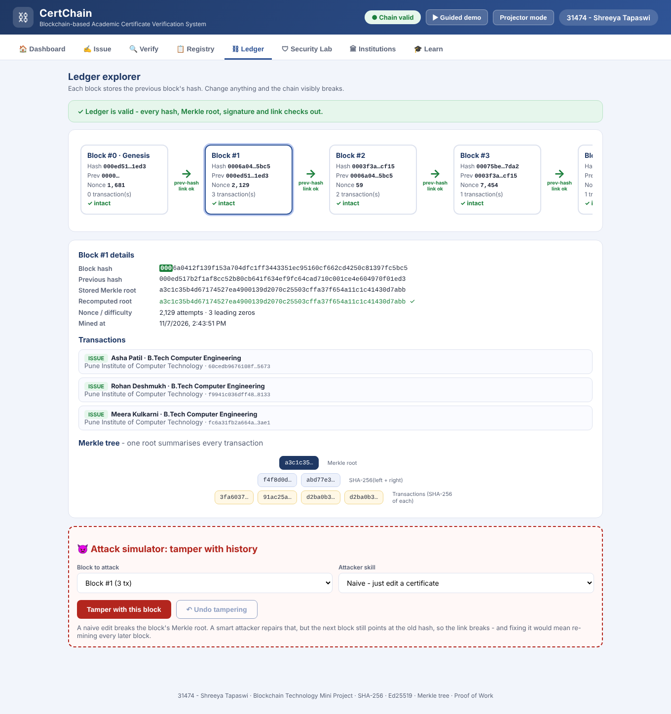

### Tamper detection: the chain visibly breaks 🔴
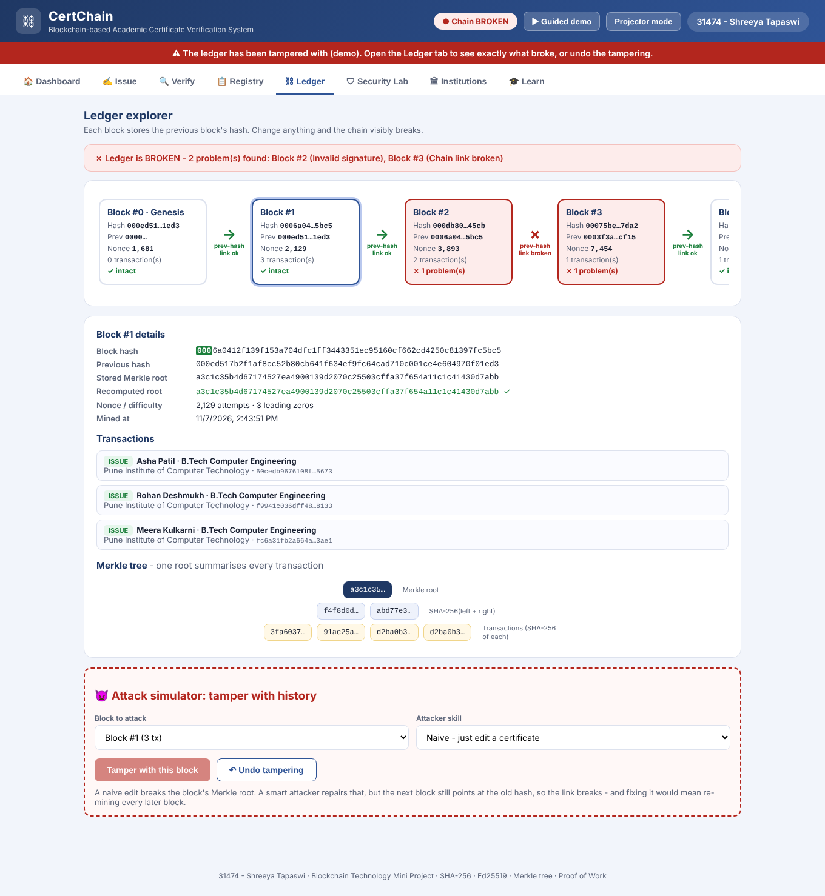

### Security Lab: every attack blocked


### Institutions & Learn
| Institutions | Learn |
|---|---|
|  | 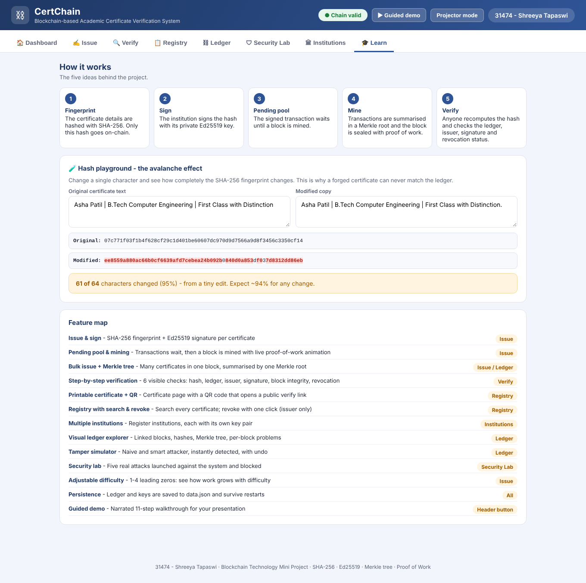 |

### Public verify page & printable certificate (with QR)
| Public verify page | Printable certificate |
|---|---|
| 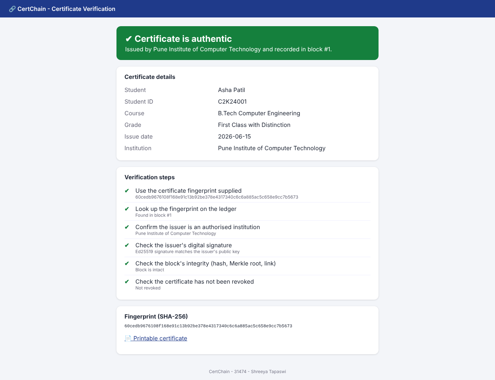 | 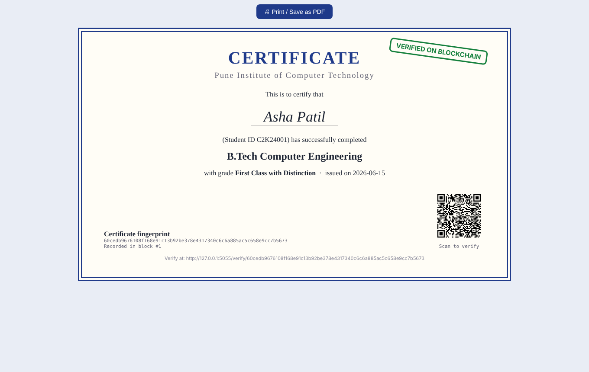 |

### Mobile
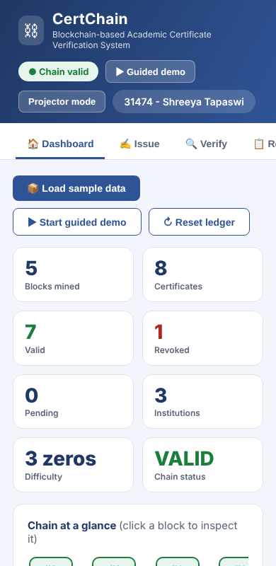

---

## 🧠 How it works

```
 Institution                          Blockchain                       Verifier
 ───────────                          ──────────                       ────────
 certificate details
   │  SHA-256
   ▼
 fingerprint ──sign (Ed25519)──▶ pending pool ──mine (PoW)──▶ Block ──▶ re-hash the details
                                                   │                    look up on ledger
                                 ┌─────────────────┴───────┐            check signature
                                 │ index · timestamp       │            check block integrity
                                 │ merkle_root ◀── txs     │            check not revoked
                                 │ previous_hash ──▶ link  │               │
                                 │ nonce · hash (000…)     │               ▼
                                 └─────────────────────────┘        ✔ authentic / ✘ not valid
```

1. **Fingerprint:** `SHA-256` of the canonical JSON of the certificate (student ID, name, course, grade, date, institution).
2. **Sign:** the institution signs `ISSUE:<hash>` (or `REVOKE:<hash>`) with its **Ed25519** private key.
3. **Pending pool:** the transaction waits until a block is mined, and a pending certificate is *not* valid yet.
4. **Merkle root:** each block summarises all its transactions in one root hash.
5. **Proof of Work:** the block hash must start with N zeros (adjustable difficulty, 1-4).
6. **Hash chain:** each block stores the previous block's hash, so editing history breaks every block after it.

### Why the attacks fail

| Attack | Defence |
|---|---|
| Unregistered "Fake University" issues a degree | Authorised-issuer registry |
| Attacker impersonates a real university | Ed25519 signature check |
| Same certificate submitted twice (replay) | Duplicate-fingerprint check |
| Rival institution revokes someone else's certificate | Only the original issuer may revoke |
| Grade or name altered on a real certificate | Different SHA-256, so it is not on the ledger |
| Old block edited (naive) | Merkle root mismatch |
| Old block edited **and re-mined** (smart) | The next block's `previous_hash` link breaks; if it is the last block, the signature check fails |

---

## 🗂 Project structure

```
├── app.py                 # Flask web app + JSON API
├── blockchain.py          # Core: hashing, Merkle tree, signing, blocks, chain, validation
├── test_blockchain.py     # 21 unit tests
├── templates/
│   ├── index.html         # Single-page UI (dashboard, issue, verify, ledger, security lab…)
│   ├── verify.html        # Public page opened by the QR code
│   └── certificate.html   # Printable certificate with QR
├── docs/screenshots/      # Images used in this README
├── requirements.txt
└── data.json              # Created automatically at runtime (git-ignored)
```

> ⚠️ Flask loads pages from the **`templates/`** folder. If the HTML files sit next to `app.py` instead, the app fails with `TemplateNotFound`.

---

## 🚀 Run it locally

```bash
git clone https://github.com/ShreeyaTapaswi/Blockchain-Academic-Certificate-Verification.git
cd Blockchain-Academic-Certificate-Verification

python -m venv .venv
source .venv/bin/activate        # Windows: .venv\Scripts\activate
pip install -r requirements.txt

python app.py                    # → http://127.0.0.1:5000
python app.py --lan              # also reachable from a phone on the same Wi-Fi (for QR scanning)
python app.py --port 8000        # custom port
```

Then click **Load sample data** on the Dashboard, or **Start guided demo** for a scripted walkthrough.

### Run the tests

```bash
python -m unittest -v
```

The 21 tests cover issuing, verification, pending state, revocation rules, signature and issuer checks, Merkle roots, naive and smart tampering, serialisation and difficulty.

## ☁️ Deploy (e.g. Render)

| Setting | Value |
|---|---|
| Build command | `pip install -r requirements.txt` |
| Start command | `gunicorn app:app --workers 1 --threads 4` |

Use **one worker**: the ledger lives in a single process's memory and is persisted to `data.json`. On free hosting the disk is ephemeral, so the ledger resets on redeploy. Click **Load sample data** to repopulate it.

---

## 🔐 Security notes & limitations

This is an educational **proof of concept** of a *permissioned* blockchain.

- Runs as a single node, with no peer-to-peer network or consensus between nodes.
- Institution private keys are stored in `data.json` for demo convenience. **A real deployment would keep keys in an HSM or the institution's own system.** Never commit `data.json`.
- Proof of Work here prevents silent tampering; in production a permissioned network would typically use PBFT/Raft-style consensus.
- The certificate details (name, grade, …) are kept **off-chain** in the app's records. Only fingerprints are on-chain.

## 🔭 Future work

- Multi-node network with consensus, and a REST API for third-party verifiers
- Hardware-backed key storage and key rotation
- Student-held wallets and DigiLocker integration
- Merkle inclusion proofs for light-client verification

---

<sub>CertChain · Shreeya Tapaswi (31474) · Blockchain Technology Mini Project</sub>
