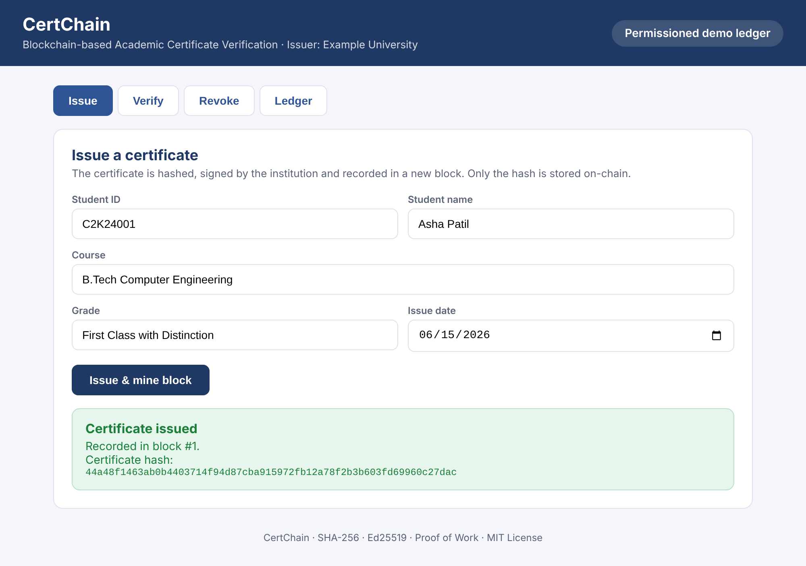
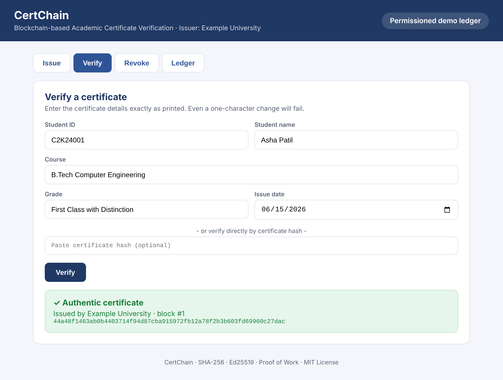
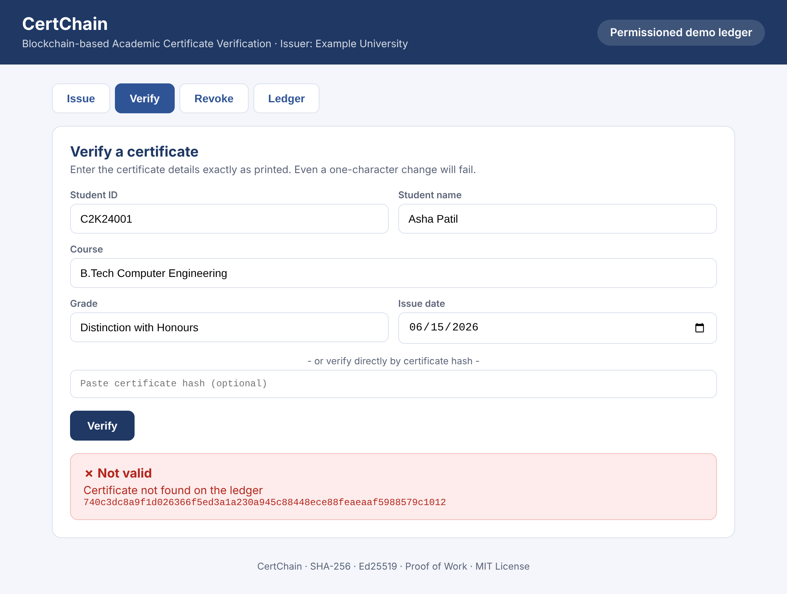
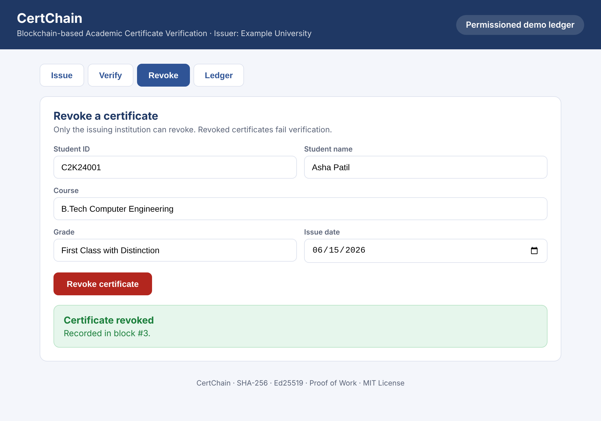
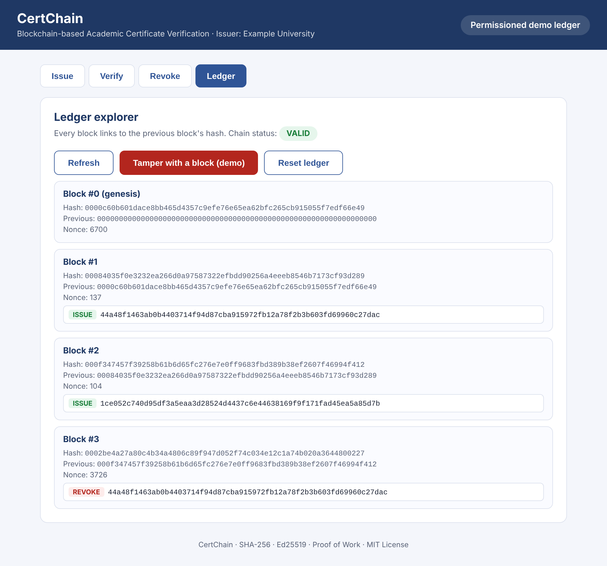
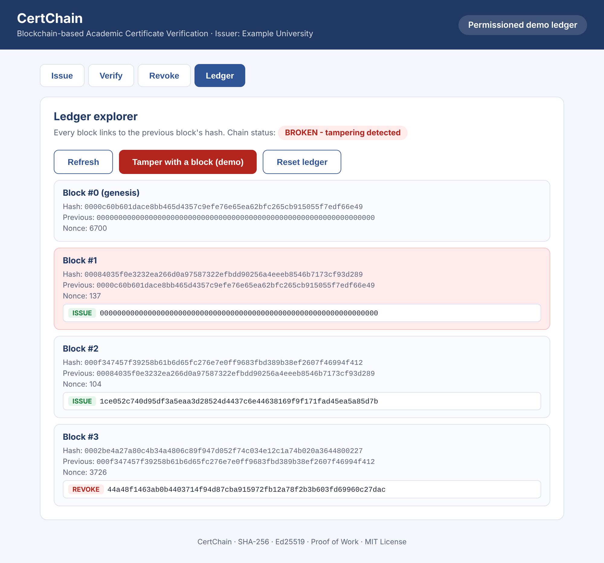
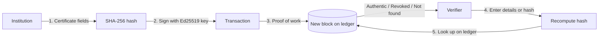

<div align="center">

# 🎓 CertChain: Blockchain-based Academic Certificate Verification

**Issue tamper-proof academic certificates. Verify them in one click.**

[](https://blockchain-academic-certificate-verification.onrender.com)


</div>

---

## 📌 Overview

Forged degrees and marksheets are a real problem, and verifying a certificate by emailing or calling the institution is slow. **CertChain** is a permissioned blockchain that fixes this. An institution issues a certificate, only its **SHA-256 hash** is written to the ledger, and anyone can verify the certificate instantly by recomputing that hash.

Because only hashes are stored, **no personal data (names, grades) ever goes on-chain**.

🔗 **Live demo:** https://blockchain-academic-certificate-verification.onrender.com
*(Free hosting sleeps when idle, so the first load can take about a minute. The ledger resets whenever the server restarts.)*

---

## 📸 Screenshots

### Issue a certificate
The certificate is hashed, signed with the institution's Ed25519 key and mined into a new block.



### Verify: authentic ✅ vs forged ❌

| Genuine certificate | Grade changed by one field |
|:---:|:---:|
|  |  |

Altering even one character changes the hash completely, so a forged certificate is reported as *not found on the ledger*.

### Revoke a certificate

| Revoke | Verify after revoking |
|:---:|:---:|
|  |  |

### Ledger explorer and tamper detection

| Chain VALID | Chain BROKEN after tampering |
|:---:|:---:|
|  |  |

The "Tamper with a block" button silently edits an old transaction. The block's stored hash no longer matches its contents, so chain validation fails and the damaged block is highlighted in red.

---

## ✨ Features

### ⛓️ Blockchain core
- Blocks linked by SHA-256 hashes, so any change to history is detectable
- Proof-of-work mining (difficulty 3: block hashes start with `000`)
- Genesis block and full chain validation (hash, proof-of-work and link checks)

### 📜 Certificate management
- **Issue:** certificate fields are hashed and recorded in a new block
- **Verify:** recompute the hash from the printed certificate, or paste the hash directly
- **Revoke:** the issuing institution can revoke, and revoked certificates fail verification
- **Duplicate protection:** issuing the same certificate twice is rejected

### 🔐 Security
- Ed25519 digital signature on every transaction
- Only registered institutions (authorised public keys) can issue or revoke
- Only the original issuer can revoke its own certificates
- Forged or altered certificates produce a different hash and are reported as not found
- Privacy-preserving: only hashes are stored, never names or grades

### 🖥️ Web UI
- Four tabs: **Issue, Verify, Revoke, Ledger**
- Green/red results with block number and issuing institution
- Ledger explorer showing each block's hash, previous hash, nonce and transactions
- VALID/BROKEN chain status with the tampered block highlighted
- Demo buttons: "Tamper with a block" and "Reset ledger"
- Responsive layout that works on a phone

### 📄 Smart contract (Solidity)
- Admin-controlled issuer whitelist
- `issueCertificate`, `revokeCertificate` and read-only `verifyCertificate`
- Events emitted for issuing, revoking and issuer changes
- Deploy on [Remix](https://remix.ethereum.org) or any Ethereum network

---

## 🧠 How it works



1. The institution enters certificate details, which are hashed together with the institution name using **SHA-256**.
2. The hash is **signed** with the institution's private key and submitted as an `ISSUE` transaction.
3. The ledger checks that the issuer is authorised, the signature is valid and the certificate is not a duplicate. The transaction is then mined into a block linked to the previous block.
4. A verifier re-enters the details (or pastes the hash). The system recomputes the hash and searches the ledger.
5. The result is **authentic**, **revoked** or **not found**. Any edit to a certificate changes its hash, so forgeries never match.

---

## 🗂️ Project structure

```
Blockchain-Academic-Certificate-Verification/
├── app.py                      # Flask server and JSON API
├── blockchain.py               # Blocks, PoW, hashing, Ed25519, issuer registry
├── demo.py                     # Command-line demo of every scenario
├── test_blockchain.py          # 9 automated unit tests
├── CertificateRegistry.sol     # Solidity smart contract version
├── templates/
│   └── index.html              # Web UI (Issue, Verify, Revoke, Ledger)
├── screenshots/           # Images used in this README
├── requirements.txt            # cryptography, flask, gunicorn
├── LICENSE
└── README.md
```

---

## 🚀 Getting started

### Prerequisites
- Python 3.10 or newer
- `pip`

### Run locally

```bash
# 1. Clone the repository
git clone https://github.com/ShreeyaTapaswi/Blockchain-Academic-Certificate-Verification.git
cd Blockchain-Academic-Certificate-Verification

# 2. (Optional) create a virtual environment
python -m venv venv
venv\Scripts\activate          # Windows
# source venv/bin/activate     # macOS / Linux

# 3. Install dependencies
pip install -r requirements.txt

# 4. Start the web app
python app.py
```

Open **http://127.0.0.1:5000** in your browser.

> On Windows use `py` instead of `python` if needed. Keep `index.html` inside the `templates` folder.

### Command-line demo

```bash
python demo.py
```

Sample output:

```
== 1. Issuing certificates ==
Mined block #1 hash=00056aa852cc99e7... (2 certificates)

== 2. Verifying a genuine certificate ==
{'valid': True, 'reason': 'Certificate is authentic', 'institution': 'Example University', ...}

== 3. Verifying a forged certificate (grade changed) ==
{'valid': False, 'reason': 'Certificate not found on the ledger'}

== 4. Unauthorised issuer is rejected ==
Rejected: Issuer is not an authorised institution

== 5. Revoking a certificate ==
{'valid': False, 'reason': 'Certificate has been revoked', ...}

== 6. Ledger integrity ==
Chain valid: True
Chain valid after tampering: False
```

### Run the tests

```bash
python -m unittest -v
```

---

## 🔌 API reference

All endpoints exchange JSON. Certificate fields are `student_id`, `name`, `course`, `grade` and `issue_date`. For verify and revoke you can send `cert_hash` instead of the fields.

| Method | Endpoint | Body | Description |
|:------:|----------|------|-------------|
| `GET` | `/` | none | Web UI |
| `POST` | `/api/issue` | certificate fields | Hash, sign and mine a new certificate. Returns `cert_hash`, `block`, `block_hash` |
| `POST` | `/api/verify` | certificate fields **or** `cert_hash` | Returns `valid`, `reason`, and the `block` and `institution` when authentic |
| `POST` | `/api/revoke` | certificate fields **or** `cert_hash` | Revoke a certificate (issuer only). Returns the block it was recorded in |
| `GET` | `/api/ledger` | none | Full chain with a `valid` flag |
| `POST` | `/api/tamper` | none | **Demo only:** corrupt a transaction to show tamper detection |
| `POST` | `/api/reset` | none | **Demo only:** reset the ledger to a fresh genesis block |

Example:

```bash
curl -X POST http://127.0.0.1:5000/api/issue \
  -H "Content-Type: application/json" \
  -d '{"student_id":"C2K24001","name":"Asha Patil","course":"B.Tech Computer Engineering","grade":"First Class with Distinction","issue_date":"2026-06-15"}'
```

---

## 🧪 Testing

9 unit tests cover:

- ✅ Valid certificate is accepted
- ✅ Unknown certificate is rejected
- ✅ Tampered content is rejected
- ✅ Unauthorised issuer is rejected
- ✅ Bad signature is rejected
- ✅ Duplicate issuance is rejected
- ✅ Revocation works
- ✅ Another institution cannot revoke
- ✅ Chain tampering is detected

---

## 🎬 Demo walkthrough

1. **Issue** a certificate, then **Verify** it (green).
2. Change the grade and **Verify** again (red, not found).
3. **Revoke** it, then **Verify** (revoked).
4. Open **Ledger**, click **Tamper with a block**, and the chain shows **BROKEN**.
5. **Reset ledger** to start over.

---

## ☁️ Deployment (Render)

1. Push this repo to GitHub.
2. On [Render](https://render.com), choose **New → Web Service** and connect the repo.
3. Use these settings:

| Setting | Value |
|---------|-------|
| Runtime | Python 3 |
| Build command | `pip install -r requirements.txt` |
| Start command | `gunicorn app:app --workers 1 --bind 0.0.0.0:$PORT` |
| Instance type | Free |

> ⚠️ Keep `--workers 1`. The ledger lives in memory, so extra workers would each hold a different chain.

---

## ⚠️ Limitations and future scope

- Single-node simulation (no peer-to-peer network); the ledger resets when the server restarts
- One built-in institution in the UI
- The demo tamper and reset endpoints are open, which is fine for a demo but should be removed in production

**Planned:**
- [ ] QR codes on certificates for instant verification
- [ ] Deployment on an Ethereum testnet
- [ ] IPFS storage for certificate PDFs
- [ ] Merkle trees for batch issuance
- [ ] Persistent storage and a multi-node network

---

## 🛠️ Tech stack

| Layer | Technology |
|-------|------------|
| Language | Python |
| Backend | Flask, Gunicorn |
| Cryptography | SHA-256, Ed25519 (`cryptography` library) |
| Smart contract | Solidity |
| Frontend | HTML, CSS, vanilla JavaScript |
| Hosting | Render |

---

## 📄 License

This project is licensed under the **MIT License**. See the [LICENSE](LICENSE) file for details.

---

## 👩‍💻 Author

**Shreeya S Tapaswi**
GitHub: [@ShreeyaTapaswi](https://github.com/ShreeyaTapaswi)

⭐ If you found this project useful, consider giving it a star!
